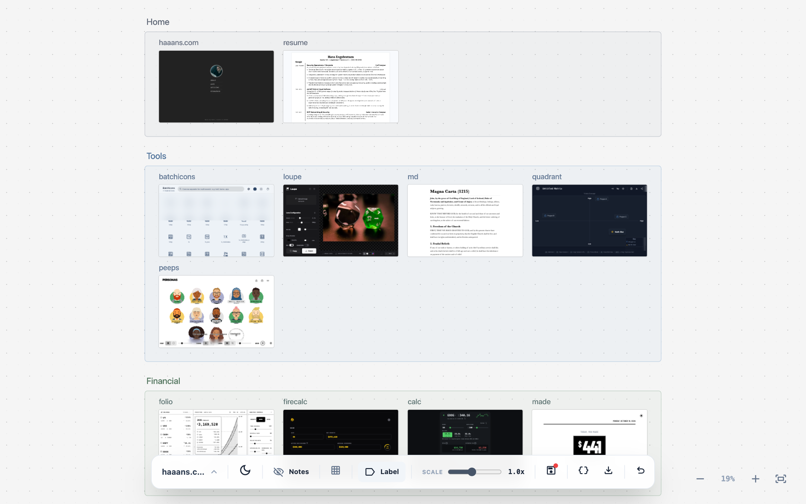
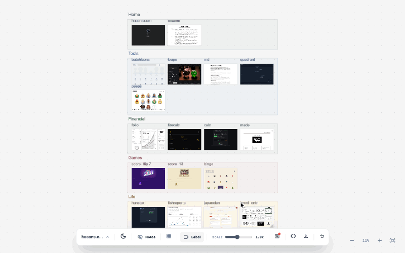
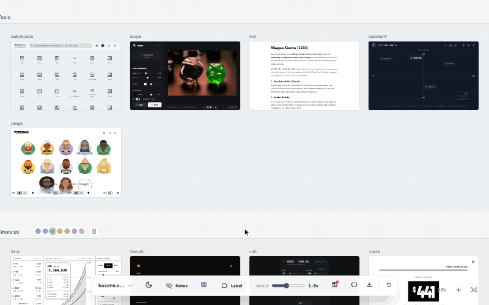
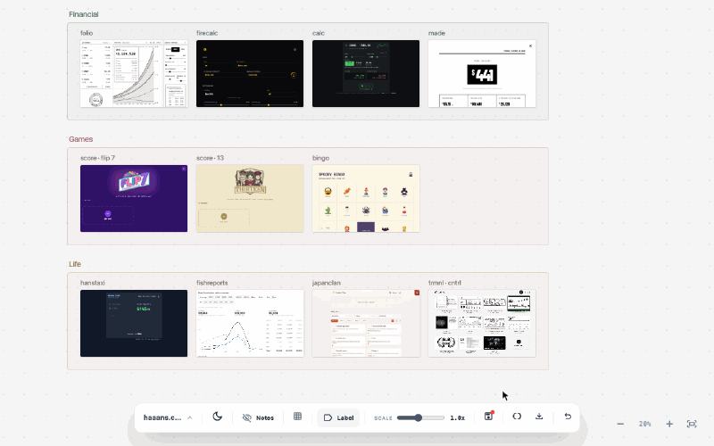
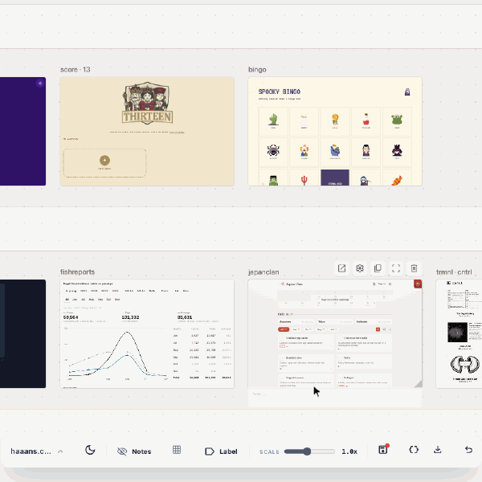
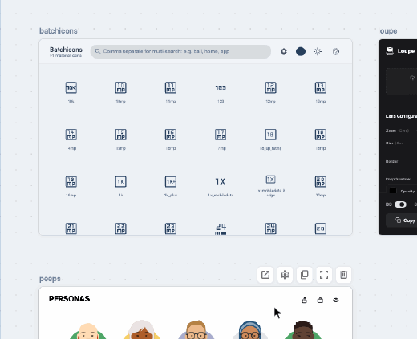

# `canvas`

An infinite canvas of live websites. Lay out sites and snippets in labeled groups, then zoom, pan and rearrange them like cards on a table.

  
[<kbd> haaans.com/canvas  </kbd>](https://haaans.com/canvas/?import=canvases/haaans-sites.json)

## Features

<table>
<tr valign="top">
<td width="50%">
<h3>Zoom from the map into a site</h3>

Pinch or hold Cmd/Ctrl and scroll to dive from the whole board into one live site, centered on wherever your cursor is.

</td>
<td width="50%">

</td>
</tr>
<tr valign="top">
<td width="50%">

</td>
<td width="50%">
<h3>Hold space to pan</h3>

Hold the space bar and drag to slide around the board, or scroll with two fingers on a trackpad.

</td>
</tr>
<tr valign="top">
<td width="50%">
<h3>Drag a label, bring its sites</h3>

Labels group what's inside them. Grab a label's title and everything in it moves along.

</td>
<td width="50%">

</td>
</tr>
<tr valign="top">
<td width="50%">

</td>
<td width="50%">
<h3>Double-click to open full screen</h3>

Open any site at full size with its source alongside it. Press Esc and you're back where you were on the board.

</td>
</tr>
<tr valign="top">
<td width="50%">
<h3>Resize and watch it reflow</h3>

Every card is a real, live page. Drag a corner to make it narrower and the site's responsive layout kicks in.

</td>
<td width="50%">

</td>
</tr>
</table>
