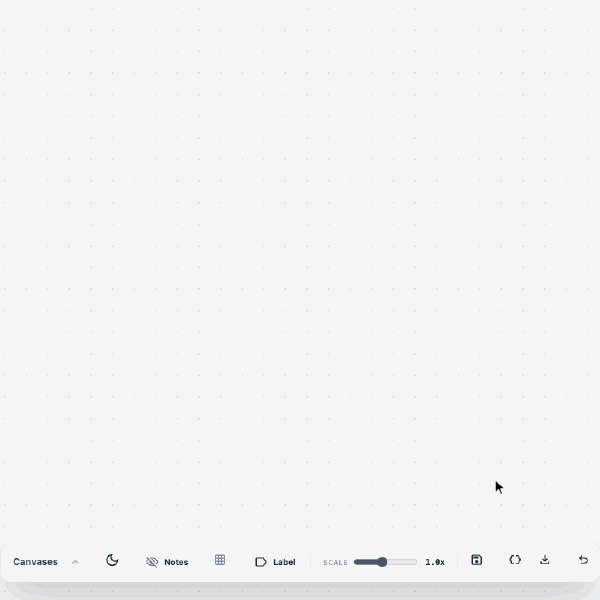
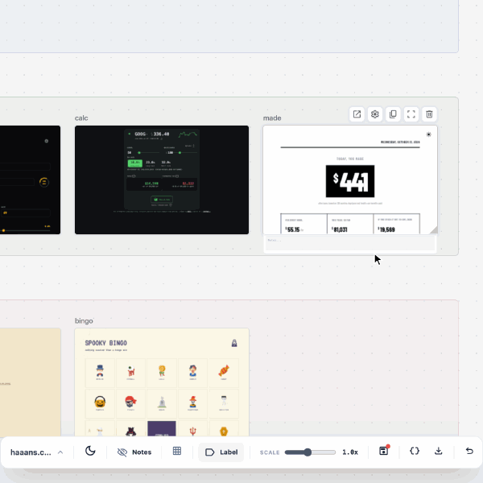
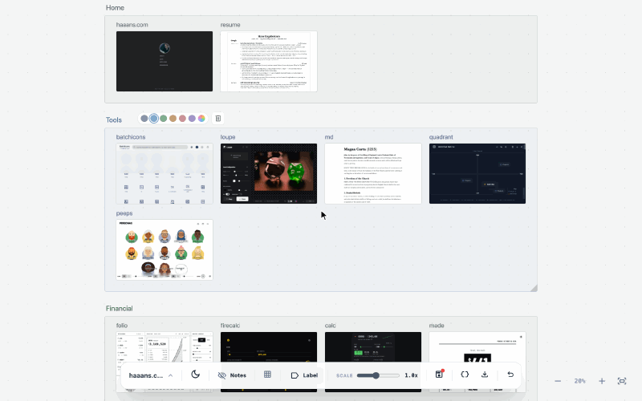

# `canvas`

An infinite canvas for live websites and HTML. Paste things in, group them under labels, and test them side by side, all saved in your browser.

  
[<kbd> haaans.com/canvas  </kbd>](https://haaans.com/canvas/?import=canvases/haaans-sites.json)

## Features

<table>
<tr valign="top">
<td width="50%">
<h3>Paste anything</h3>

Paste a URL and it becomes a live, working card. Paste HTML and it renders on the spot. Each card lands in the next open space.

</td>
<td width="50%">

</td>
</tr>
<tr valign="top">
<td width="50%">

</td>
<td width="50%">
<h3>Manage and organize everything</h3>

Hold space and drag to pan, add a label, name it and pick its color. Drag a label and everything inside comes with it.

</td>
</tr>
<tr valign="top">
<td width="50%">
<h3>Save &amp; share without databases</h3>

Canvases save to your browser's local storage, with no account or server. Copy a whole canvas as JSON to share it, or load one from a file with <code>?import=</code>.

</td>
<td width="50%">

</td>
</tr>
<tr valign="top">
<td width="50%">

</td>
<td width="50%">
<h3>Edit and add notes</h3>

Double-click any card to see it full size beside its source. Every card has a notes field, and HTML snippets get live controls for their CSS variables.

</td>
</tr>
<tr valign="top">
<td width="50%">
<h3>Responsive testing, canvas windows</h3>

Every card is a real page in its own window. Drag a corner to resize it and watch the site's responsive layout kick in.

</td>
<td width="50%">

</td>
</tr>
</table>
